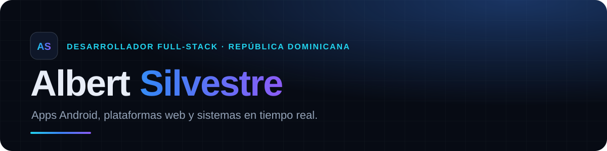
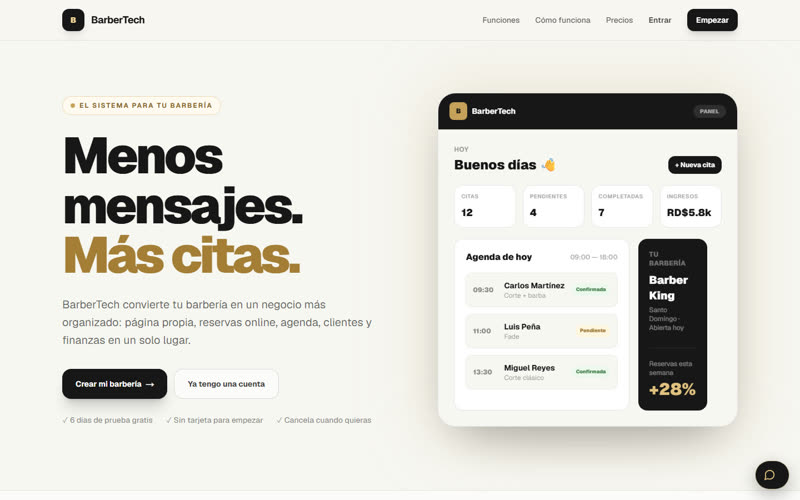
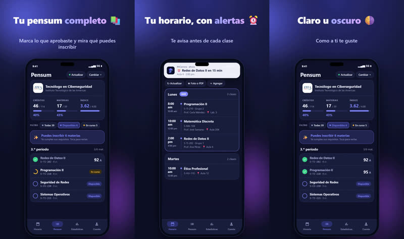
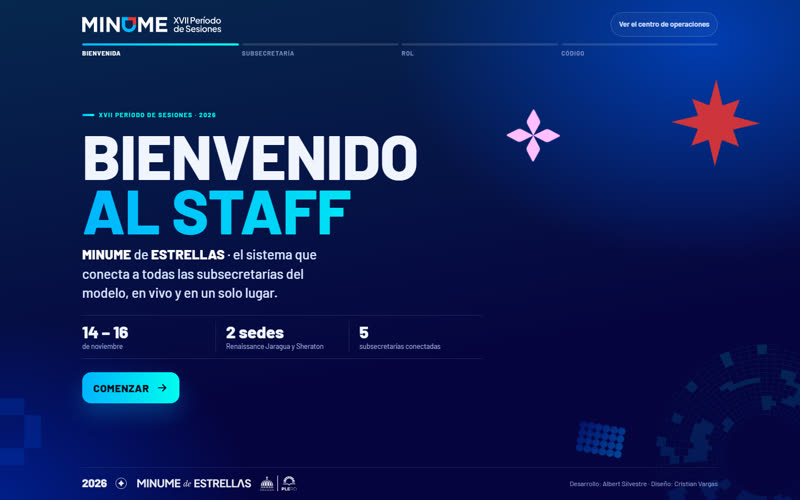
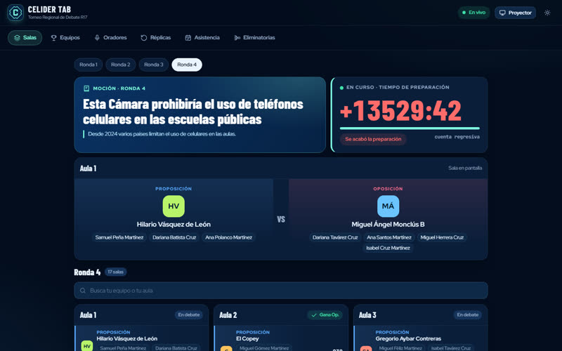

  
  

Construyo software que la gente usa de verdad: **apps Android, plataformas web y sistemas en tiempo real**, desde la base de datos hasta la pantalla. Me gusta resolver problemas concretos, como una barbería que vive en WhatsApp, un estudiante perdido con su pensum o un evento de cientos de personas que necesita coordinarse en vivo.

## Proyectos destacados

<table>
  <tr>
    <td width="50%" valign="top">
      
      <h3><a href="https://github.com/SrAlbert22/barbertech">BarberTech</a></h3>
      SaaS para barberías: página propia de reservas, agenda en tiempo real, clientes y finanzas. Multi-tenant con RLS.  
      <code>Next.js 16</code> <code>React 19</code> <code>TypeScript</code> <code>Supabase</code>  
      <a href="https://barbertech.site"><b>barbertech.site →</b></a>
    </td>
    <td width="50%" valign="top">
      
      <h3><a href="https://github.com/SrAlbert22/micarrera">MiCarrera</a></h3>
      App Android y web para universitarios: pensum de 37 universidades, horario con alertas, test vocacional y aula virtual.  
      <code>Kotlin</code> <code>Jetpack Compose</code> <code>React</code> <code>Supabase</code>  
      <a href="https://micarrera-beta.vercel.app"><b>Abrir la web →</b></a>
    </td>
  </tr>
  <tr>
    <td width="50%" valign="top">
      
      <h3><a href="https://minume-xvii.vercel.app">MINUME XVII</a></h3>
      Centro de operaciones del staff de un modelo de la ONU: seis sistemas conectados en vivo, SOS con Web Push y maqueta 3D de las sedes.  
      <code>JavaScript</code> <code>Three.js</code> <code>Supabase Realtime</code> <code>PWA</code>  
      Código privado del cliente · diseño con Cristian Vargas
    </td>
    <td width="50%" valign="top">
      
      <h3><a href="https://github.com/SrAlbert22/celider-tab">CELIDER Tab</a></h3>
      Tabulador en vivo para torneos de debate WSDC: portal público con proyector, boletas desde el teléfono de cada juez.  
      <code>JavaScript</code> <code>Supabase</code> <code>Realtime</code> <code>RLS</code>  
      <a href="https://celider-tab.vercel.app/?t=demo#vivo"><b>Ver demo →</b></a>
    </td>
  </tr>
</table>

## Con qué trabajo

**Móvil:** Kotlin · Jetpack Compose · Material 3 · Media3 
**Web:** TypeScript · React · Next.js · Vite · Tailwind · Three.js 
**Datos y servidor:** PostgreSQL · Supabase (RLS, RPC, Edge Functions, Realtime) · Web Push 
**Herramientas:** Git · Vercel · Python · Blender

---

¿Tienes un proyecto en mente? Escríbeme por <a href="https://www.instagram.com/albertsilvestredev/">Instagram</a> o mira todo en <a href="https://albert-silvestre.vercel.app">mi portafolio</a>.
